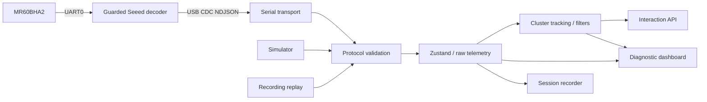

# Data flow and extension boundary

Serial byte decoding, newline framing, packet parsing and validation are distinct modules. Every source is versioned and validated: serial through `LineParser`, replay through `importSession`, and simulation through the typed simulator generator (covered by tests). Source changes close the previous transport, stop recording, reset trackers/counters, and clear stale device metadata. A disconnected serial link immediately suppresses interaction.

The tracker keeps one bounded trail per active cluster, removes duplicate candidates, applies EMA and a positional dead zone, and selects a sticky or nearest primary. It processes only new target measurement timestamps. Valid empty reports may briefly hold a previous target; unavailable reports, explicit absence, radar timeout and serial disconnection suppress primary interaction. Presence and target times are mapped from uint32 device uptime into the host clock using their age on receipt. Firmware uptime rollover is handled; obvious restart resets tracking.

The bridge output interval controls host bandwidth, not sensor measurement cadence. Frame rates use accepted sensor counters over a four-second window. Cached coordinates never count as new measurements.

Recordings preserve raw protocol packets and host-relative offsets. Replay has a virtual clock independent of wall time and speed. Pause freezes this clock. Seek resets tracking and reapplies preceding packets, preserving filter history; current filter settings apply during replay. This is O(n) up to the selected seek point, bounded by the session limit. Original sensor timestamps remain unchanged in the recording.

Consumers use `interactionAPI.getSnapshot()` and `interactionAPI.subscribe()` from `web/src/core/interaction.ts`. `primary` and `velocity` use native metres and metres/second. `screen` uses display inversion, maps the visible ±range to [0,1] and clamps outside positions. `movementIntensity` clamps the position-derived speed / 2 m/s to [0,1]; it is an application mapping, not a radar confidence or calibrated activity classifier. `freshness` decreases linearly with target age. A null primary means downstream rendering should stop following the target. The timestamp is a host epoch time for live sources and relative virtual session milliseconds during replay.

Phase 1 remains independent of the renderer. Phase 2 adds Three.js/WebGL2 in a dynamically imported Particle Experience view behind the existing normalized API; see [particle architecture](particles-architecture.md). Protocol additions still require an explicit version decision and validation changes. No cloud service is used.
