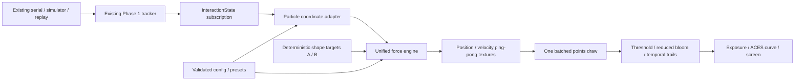

# Particle architecture

`App.tsx` remains the source-lifecycle owner. Navigation hides the diagnostic markup without tearing down its serial reader or timers. The particle view is dynamically imported and mounts a separate renderer; navigating back disposes it. This avoids a second serial reader and keeps Phase 1 protocols and firmware unchanged.

`particles/config.ts` defines bounded configuration, the six presets, quality profiles, colors and portable import/export. `store.ts` supplies a separate Zustand particle store and browser-local persistence. Raw radar packets never enter the engine. `adapter.ts` accepts only the existing interaction interface plus the diagnostic calibration settings. Renderer code does not parse JSON from serial or depend on `Telemetry`.

`gpu.ts` implements explicit ping-pong passes equivalent to the architecture described by Three.js GPUComputationRenderer. Two position/age and two velocity/seed render targets persist across frames. Two read-only target/seed data textures hold formation endpoints. Texture dimension is `ceil(sqrt(count))`; padded texels have stable values but only the requested number of point vertices is drawn. This supports exact 10k/30k/60k/100k draw counts rather than silently rounding counts to texture area.

Each fixed step first updates velocity from old position/velocity and the blended shape target. The position pass then integrates using **new velocity**, giving semi-implicit Euler integration. Acceleration and speed are clamped, velocity receives exponential damping, and a soft radial boundary can restore escaped particles. Position W stores cyclic age and velocity W stores a seed. Age changes brightness subtly but does not respawn positions. The clock uses 1/60 s steps and at most four steps per rendered frame; elapsed time beyond its bounded catch-up budget is dropped instead of destabilizing integration.

`formations.ts` generates six deterministic targets indexed by particle number. No per-frame target randomization occurs. A morph interpolates targets using a smoothstep curve, while actual positions continue through spring forces. An interrupted morph first evaluates its current blended target into endpoint A before generating endpoint B; this prevents target discontinuities even when operators switch presets rapidly. Geometry, GPU state and point materials are retained during morphs.

`shaders.ts` implements smooth analytic curl from a trigonometric vector potential, a second flow scale, spring attraction, damping, magnetic falloff, near-field repulsion, localized/global vortex motion, directional visitor flow and movement-driven turbulence/pulses. The same validated parameters drive the reduced CPU fallback; it omits the GPU flow field's second octave and simplifies some vortex/turbulence details. This is an artistic force field, not a Navier–Stokes or incompressible fluid solver. There are no per-particle meshes or neighbor-search allocations.

`post.ts` uses a scene target, reduced-resolution thresholded separable bloom and two temporal history targets. History uses a decaying maximum rather than unbounded frame addition, limiting burn-in. Bloom has independent intensity, quality-scaled resolution and a luminance threshold. The final pass applies controlled exposure, an ACES approximation, gamma conversion and a dark vignette background. State textures use nearest filtering; visual post-process targets use linear filtering.

`engine.ts` owns Three.js, OrbitControls, the point batch, compute passes, post-processing, frame loop, resize observation, optional disjoint GPU timer and adapter subscription. It interpolates force/color changes rather than reallocating resources. It suspends on a hidden document and resets catch-up/history on resumption. Context loss stops the loop; restoration rebuilds resources and resumes the selected effect. GPU context restoration and explicit count changes may restart particle positions; ordinary effect changes and sensor loss do not. WebGL itself may be unavailable or restoration may fail, which produces an explicit status instead of blocking diagnostics.

The adapter outputs world-space attraction/direction. Before simulation, `sceneInput()` applies the inverse sculpture rotation to those vectors; debug geometry uses that same local transform. This keeps a visitor's physical left/right interaction stable while the displayed sculpture rotates.

Disposal cancels RAF, removes visibility/context listeners, disconnects ResizeObserver, unsubscribes interaction state, disposes controls, geometry, materials, all render targets/seed/target textures and timer queries, disposes the renderer and releases its context. Configuration changes do not construct thousands of objects or meshes. Large allocations occur only on count changes, renderer creation or restoration.

References: [Three.js WebGLRenderer](https://threejs.org/docs/#api/en/renderers/WebGLRenderer), [upstream GPUComputationRenderer source](https://github.com/mrdoob/three.js/blob/r186/examples/jsm/misc/GPUComputationRenderer.js), [OrbitControls](https://threejs.org/docs/#examples/en/controls/OrbitControls). Implementation was checked against installed Three.js 0.186.1 source rather than assuming legacy APIs.
